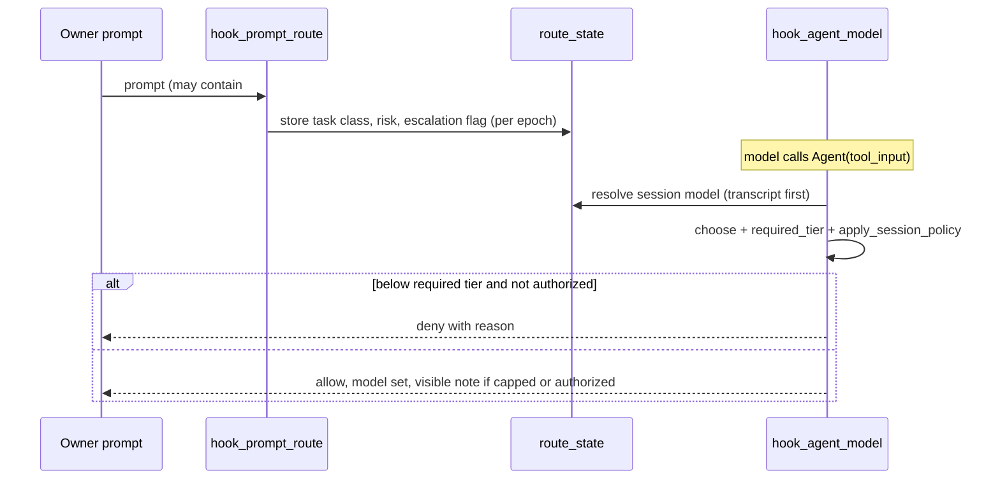

# Architecture and dataflow (verified paths)

Evidence labels: SOURCE_VERIFIED (read in code), TEST_VERIFIED (a named test passed in the final gate), RUNTIME_VERIFIED, MEASURED, INFERRED, UNVERIFIED.
Note: the path numbering 1-9 below is this document's own; the original audit reports were not available to the author, so
the mapping to the audit numbering is INFERRED from the checkpoint ledger. Paths 4 and 7 are only partly traced.
All paths are relative to the repository root. Test results refer to `final_pytest.txt` (see GATE_LOG.md).

## Path 1 - memory retrieval (search)
- Entry: MCP `memory_search` / CLI `recall_cli` -> `03_IMPLEMENTATION/packages/interfaces/memory_access.py:196 search()` -> `MemoryController.search()` (principal AI_AGENT). SOURCE_VERIFIED.
- Scoring: `hybrid_retrieval.py` tokenizer (`tokenize` :69, NFKD fold :65). `generate_candidates` scores the whole pool, then slices (`candidate_generation.py:178-180`), so the "window before scoring" concern was REFUTED on the main path. SOURCE_VERIFIED (audit A).
- State: in-memory index built by `FileStorageEngine` (`file_engine.py:64-101`); skipped files are counted (`skip_report` :85) and audited (`storage_skipped`). The controller exposes `candidate_trace.skipped_corrupt/skipped_paths` (`memory/controller.py`).
- Authorization: principal + lifecycle trust rules (ACTIVE/REVIEW; invariants I-001..I-012, I-RETRIEVAL). Returned text carries `review_required`/`review_reasons` (`memory_access.py:80-92`), a flag only, never reordering.
- Failure modes: corrupt note = skipped but now visible (TEST_VERIFIED `regression/test_retrieval_correctness_overnight.py::test_corrupt_note_reported_and_valid_matches_survive`); scanner failure = flagged, not clean (`redteam::test_rt05_scanner_failure_flags_instead_of_calling_text_clean`).
- Gaps: `security.py:6 sanitize_query` strips `<...>` content (L-M, not fixed); tie order differs between candidate window (asc id) and final (desc) (L, not fixed).

```mermaid
sequenceDiagram
  participant C as MCP/CLI client
  participant M as memory_access.search
  participant K as MemoryController
  participant S as FileStorageEngine
  C->>M: query, limit, principal
  M->>K: search(sanitized query)
  K->>S: candidates (index; skipped files counted)
  K->>K: score whole pool, slice
  K-->>M: results + candidate_trace
  M-->>C: results + review_required flags
```

## Path 2 - memory proposal
- `memory_access.py:282 propose()` -> uuid5 of normalised title/body/type/provenance/principal -> existing candidate returned with `deduplicated: true` (:310) else new REVIEW/unverified note (:332). Nothing becomes verified here. SOURCE_VERIFIED; TEST_VERIFIED `redteam::test_rt06_*`, `test_rt07_*`.
- Gap: dedup is exact-after-normalisation (title only normalised); near-duplicates and a rate cap are not implemented.

## Path 3 - direct vault routes (vault_resolve / vault_read)
- Traversal refused on canonical routes: TEST_VERIFIED `redteam::test_rt08_vault_resolve_and_read_refuse_traversal`. Raw text is returned with a label; the injection flag exists on memory_get/search only (MED-5 partial). SOURCE_VERIFIED.

## Path 4 - working-memory admission / recall ranking across `cognitive_core/`
- UNVERIFIED (not traced end to end by any audit).

## Path 5 - router hook chain (Claude Code subagent launch)
- Entry points (registered in `.claude/settings.json`): `hook_prompt_route.py:164 main` (UserPromptSubmit), `hook_agent_model.py:407 main` (PreToolUse Agent), `hook_enforce_route.py:204 main`, `hook_agent_usage.py:106 main` (PostToolUse), `hook_resume_guard.py:88 main` (SendMessage). SOURCE_VERIFIED.
- Authorization of escalation: only the owner prompt can carry `#escalate` (`hook_prompt_route.py:107 escalation_authorized`, stored per prompt epoch via `sync_escalation` :112). `tool_input` can never set it (TEST_VERIFIED `escalation_matrix::test_t1_tool_input_text_never_authorizes`, `redteam::test_rt12_*`).
- Decision: `choose()` (`hook_agent_model.py:353`) -> `required_tier` (:303) / `needs_opus` (:292) -> `apply_session_policy` (:328): review/verify brief or critical/live-op -> opus; high-risk implementer -> sonnet; below the required tier and unauthorized -> DENY with reason; normal work above session tier -> capped with a visible note; unknown session model -> cheapest tier.
- Session model: `route_state.resolve_session_model` (:226), transcript last assistant model first, stored value as fallback (TEST_VERIFIED `escalation_matrix::test_f4_*`).
- State/persistence: per-session JSON and markers under the state dir (`route_state.py:33-200`), atomic writes (:158), `seen_event` replay guard (:357).
- Failure modes: malformed payload -> fail open without granting escalation (`redteam::test_rt09_*`, `escalation_matrix::test_t7_*`); `COST_ROUTER_OFF=1` -> every hook returns silently (`route_state.py:422`).
- Gaps: advisory/breaker logic in `hook_enforce_route` was only exercised indirectly; weak assertions in `test_cost_router_claude_hooks.py` (:314, :430...) not strengthened.



## Path 6 - install and self-update
- `hook_self_update.py:89 main` honours `COST_ROUTER_OFF` (:90) and `COST_ROUTER_NO_SELF_INSTALL=1` (:92); `install.py:471-473` makes `--session-start`/`--self-update` inert under either switch. TEST_VERIFIED `test_cost_router_self_update.py::test_self_update_hook_main_is_inert_under_the_isolation_switches`, `::test_install_self_update_is_inert_under_no_self_install`, `redteam::test_rt01_*`.
- Residual HIGH-2: when the switches are not set, the hook still clones unpinned `main` and runs its installer (SOURCE_VERIFIED, see SECURITY_REDTEAM_RESULTS.md proposal). Global copy `~/.claude/skills/cost-router` is rewritten whenever a session starts at repo root with switches unset.

## Path 7 - agent usage telemetry
- `hook_agent_usage.py:43 build_entry` -> `route_state.record_agent_usage` (:377) sidecar JSONL, strings capped, corrupt lines skipped, idempotent per event (TEST_VERIFIED `test_cost_router_claude_hooks.py::test_agent_usage_recorded_once_and_idempotent`). Missing usage stored as null with `usage_complete=false`. The user-writable sidecar is unauthenticated (RT15 residual). Provider-side telemetry (`actual_usage_telemetry.py`, protected) was NOT traced: UNVERIFIED.

## Path 8 - benchmark token accounting
- `30_SCRIPTS/evaluation/claude_cost_router_benchmark.py`: `stream_metrics` :957, `attribute` :759, `metrics_from` :914, `run_once` :1005, `summarize_tokens` :1285, `reconciliation` :1353, `recompute` :1404; check tool `30_SCRIPTS/evaluation/token_accounting_check.py`. Contract in TOKEN_ACCOUNTING_VALIDATION.md. Fixtures `20_TESTS/fixtures/telemetry/`.

## Path 9 - resume guard and counters
- `hook_resume_guard.py:42 decide` counts resumes via `route_state.resume_count` (:273) / `record_resume` (:331) under an O_EXCL lock; unresolved transcript targets are counted by id so a missing transcript no longer fails open. TEST_VERIFIED `redteam::test_rt11_*`, `test_rt14_*`.
- Gap: the Antigravity copy `.agents/skills/cost-router/lib/route_state.py` still has the unlocked read-modify-write (not mission-edited).
